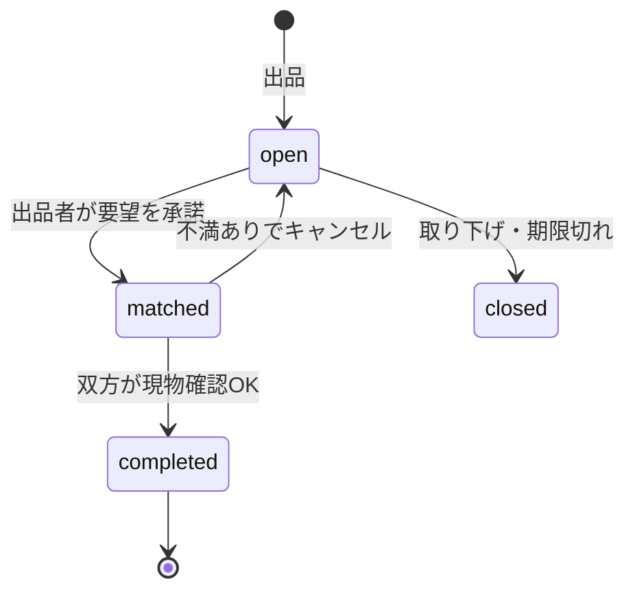

決まったことを反映した**要望書の確定版**を作ったよ。変更点は次の4つ。

- 画像はVercel Blobに保存して、DBにはURLだけ入れる
- 学内限定は、メールの形式チェック（`siw230100`＋`01`〜`40`＋学校ドメイン）で確認する
- 要望は、出品済みじゃなくてもOKで、出品と同じ入力項目にする
- 現物確認は、出品者と要望者の両方向にする

形式だけの確認だと、学籍番号を知ってる人が他人のアドレスで先に登録できちゃう。割り切るのはOKだけど、将来案として「メール確認リンク」を②に入れておいたよ。

---

# SIW物々交換所（仮） 機能検討 要望書

## 1. アプリケーションの概要・コンセプト
さいたまITWEB専門学校（SIW）の学生だけが使える、「いらない物」と「欲しい物」をセットで公開し、学内で手渡しして物々交換できるWebアプリ。
この案を選んだ理由は、お金も配送も使わず、同じ学校の人同士なら現物を直接見て確かめられるので、フリマアプリより安心で気軽に交換できると考えたため。

## 2. 解決する課題とターゲットユーザー
- **対象ユーザー：** SIWの在校生。進級・卒業・引っ越し前に物が余る人や、教科書・機材・グッズを買わずに手に入れたい人。まずは学籍番号01〜40のクラス（最大40人）から始め、ルールを設定で変えて他クラスにも広げられるようにする。
- **解決するペインポイント：**
  - フリマアプリは手数料・発送・不特定多数の相手が面倒で不安
  - 学内の掲示や口頭では、必要な人に情報が届かない
  - 「これが欲しい」があっても、持っている人と出会えない
- **提供する独自の価値（ベネフィット）：**
  - 学内限定＋手渡し前提（発送なし・手数料なし）
  - 出品者が「欲しい物」も出せる、双方向の交換
  - 要望は出品と同じ形式で出せるので、出品しなくても気軽に参加できる
  - 複数の要望の中から出品者が選べる
  - 現物確認で不満があれば、どちらからでもキャンセルできる安心感
  - 成立前は公開コメント、成立後は2人だけのDM

## 3. 動作・作業環境（半角英数字のみ）
- **ドキュメントルート（フォルダ名）：** / siw-barter /
- **データベース名（仮）：** siw_barter

## 4. 実装機能一覧
> 用語：**出品**＝いらない物の公開／**要望**＝出品に対する「この物と交換したい」の申し込み／**成立**＝出品者が要望を承諾した状態／**完了**＝双方の現物確認が済んだ状態

### ① 必須機能（コアとなる体験・最低限必要な機能）
- [ ] 会員登録・ログイン：メールアドレス＋パスワード＋ニックネーム。メールの形式を満たす人だけ登録できる（形式：`siw230100`＋学籍番号`01`〜`40`＋`@`＋学校のドメイン）。検証は必ずサーバー側で行い、小文字化して比べる。同じメールは1アカウントだけ
- [ ] 出品：タイトル・説明・カテゴリ・画像（最大3枚、Vercel Blobに保存）・受け渡し希望（場所／時間帯）
- [ ] 商品の状態の入力：5段階（新品同様／良好／使用感あり／傷・汚れあり／ジャンク）＋補足コメント
- [ ] 「欲しい物」の登録：出品時に、交換してほしい物（カテゴリ＋自由記述）を任意で入力
- [ ] 一覧・検索・絞り込み：キーワード／カテゴリ／状態／「欲しい物」で検索
- [ ] 要望の送信：出品済みでなくてもOK。差し出す物を出品と同じ項目（タイトル・説明・カテゴリ・状態・画像最大3枚）で入力し、メッセージを添えて申し込む
- [ ] 要望の選択・承諾：出品者が届いた要望から1つ選んで承諾。他の要望には自動で「見送り」を通知
- [ ] 公開コメント：成立前は出品ページ上で誰でも見られる質問・やりとり
- [ ] 2人専用DM：成立後は、成立した2人だけが閲覧・送信できる（受け渡しの日時・場所の調整）
- [ ] 現物確認とキャンセル：受け渡し時に、出品者は要望者の物を、要望者は出品物を確認し、「OK」か「不満あり（理由必須）」を選ぶ。双方OKで「完了」。どちらかが不満ありならキャンセルとなり、出品は「公開中」に戻る
- [ ] マイページ：自分の出品／送った要望／受けた要望／進行中の交換／履歴

### ② 付加価値・トレンド機能（さらに面白く・使いやすくする機能）
- [ ] メール確認リンク：登録時に確認メールを送り、そのアドレスの本人だけが登録できるようにする（なりすまし登録の対策）
- [ ] 管理者機能：アカウントの無効化、出品・コメントの削除
- [ ] 欲しい物マッチ通知：自分の出品が誰かの「欲しい物」に合うと知らせる
- [ ] ウォッチ（お気に入り）：気になる出品を保存
- [ ] 出品の有効期限：卒業や長期休み前に自動で非公開化
- [ ] 信頼バッジ：交換完了数・キャンセル率を表示
- [ ] 通報機能：不適切な出品やコメントを管理者に報告
- [ ] 受け渡し場所プルダウン：学内の決まった場所から選ぶ
- [ ] 「譲ります」モード：欲しい物なしで出品

### ③ 実務・セキュリティ要件（安全な運用のための必須要件）
- [ ] パスワード暗号化：ハッシュ化（パスワードハッシュ関数）による安全なDB保存
- [ ] 脆弱性対策：SQLインジェクション（パラメータ化クエリ）、XSS（出力エスケープ）、CSRF（SameSite Cookie＋トークン）への基本対策
- [ ] 認可チェック：DMは当事者のみ、出品の編集・承諾は出品者のみ。IDを書き換えても他人のデータに触れない
- [ ] ログイン試行の回数制限：学籍番号は推測できるため、パスワード総当たりを防ぐ
- [ ] 個人情報の保護：メールアドレスは他のユーザーに表示せず、ニックネームだけ表示する
- [ ] 画像アップロード制限：ログイン済みの人だけ、形式（JPEG／PNG／WebP）とサイズを制限。ブラウザ側で圧縮してから送る
- [ ] 取引禁止物のルール明記：現金・金券・危険物・酒・タバコ・偽物など

## 5. 次のステップ（シニアエンジニアからのアドバイス）

**出品の状態遷移（案）**



**テーブル案（たたき台）**

| テーブル | 主なカラム | 役割 |
|---|---|---|
| users | id, email(unique・小文字), password_hash, nickname, role, is_active, created_at | 会員（roleは user／admin） |
| items | id, owner_id, title, description, category, condition, wanted_text, wanted_category, pickup_note, status, expires_at | 出品と欲しい物 |
| item_images | id, item_id, url, sort_order | 出品画像（urlはVercel BlobのURL） |
| offers | id, item_id, requester_id, title, description, category, condition, message, status | 要望（差し出す物の情報を持つ） |
| offer_images | id, offer_id, url, sort_order | 要望の画像 |
| comments | id, item_id, user_id, body, created_at | 成立前の公開コメント |
| trades | id, item_id, offer_id, owner_id, requester_id, owner_check, requester_check, cancel_reason, status | 成立後の取引と現物確認 |
| messages | id, trade_id, sender_id, body, created_at | 成立後の2人DM |

**学内限定チェックの実装イメージ**
```ts
const ID_PATTERN = /^siw230100(0[1-9]|[1-3][0-9]|40)$/;

function isAllowedEmail(email: string): boolean {
  const parts = email.trim().toLowerCase().split("@");
  if (parts.length !== 2) return false; // "@"が複数あるものを弾く
  const [local, domain] = parts;
  return domain === process.env.ALLOWED_EMAIL_DOMAIN && ID_PATTERN.test(local);
}
```
学校のメールのドメインはまだ分からないので、環境変数`ALLOWED_EMAIL_DOMAIN`に切り出しておく。実装前に、実際のアドレスで確認してね。

**アドバイスと懸念点**
- **なりすまし登録：** 形式チェックだけだと、他人の学籍番号のアドレスで先に登録できる。登録は1アドレス1アカウントなので、本人が後から登録できなくなる恐れもある。当面は管理者が無効化できる機能（②）で対応して、余裕があれば確認メール（②）を入れる
- **利用者が最大40人：** 出品数が少ないとマッチしにくい。ルール（接頭辞と番号範囲）をコードに直書きせず、設定として切り出して、他クラスに広げやすくしておく
- **画像：** Vercel Blobに保存してDBにはURLだけ入れる。無料枠の上限や超過時の挙動は、ダッシュボードで確認しておく。ブラウザ側で圧縮して容量を節約する
- **二重成立：** 同時に承諾が走る場合に備えて、トランザクションと「statusがopenの時だけ更新する」条件付きUPDATEで防ぐ。トランザクションは1970〜80年代にジム・グレイらが体系化したDBの基本
- **設計の根拠：** 物々交換の壁は、経済学者ジェヴォンズ（1875年）が「欲求の二重の一致」と呼んだ問題。このアプリは「欲しい物」と要望を集めて、その壁を下げている。ここが独自性の核になる
- **開発順のおすすめ：** 認証 → 出品（画像含む）→ 一覧 → 要望 → 承諾 → DM → 現物確認／キャンセル。最後に管理者機能と通知

---

📌 学生へのメッセージ
1. この要望書をコピーして、プロジェクト直下に `01_proposal.md` というファイル名でVSCode等に保存してください。
2. エラー防止のため、ドキュメントルートのフォルダ名やDB名は【半角英数字（ハイフン・アンダースコア可）】のみを使用してください。

---

これでブレストは完了だよ、おつかれさま！直したい所があれば何でも言ってね😊 次は`02_design.md`（画面とAPIの設計）に進むのもアリだよ。

（現在のラリー数: 8/15）
