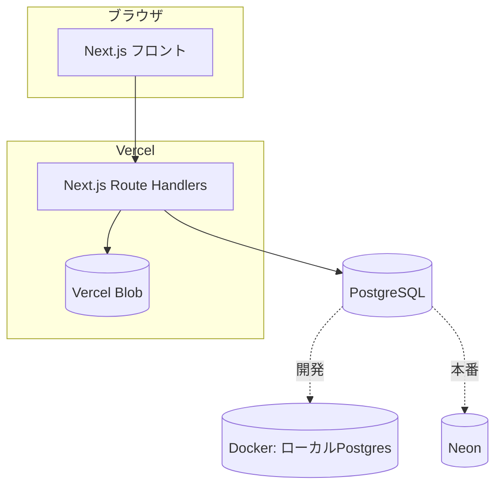
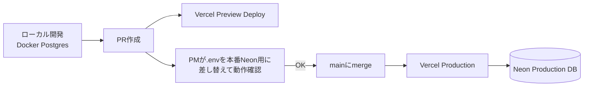

# SIW物々交換所（仮） 技術定義書

対象読者：開発メンバー全員。実装前に全員が同じ構成を見れるようにするための定義書。

## 1. 結論（技術スタック）

| 領域 | 選定 | 理由 |
|---|---|---|
| フレームワーク | **Next.js (App Router) + TypeScript** | フロント／API(Route Handlers)が1プロジェクトで完結。Vercelデプロイ・Vercel Blobと相性が良い |
| DB（開発） | **PostgreSQL（Docker Compose）** | 本番(Neon)と同じエンジンでローカル差異を防ぐ |
| DB（本番） | **Neon（Serverless Postgres）** | 既定どおり |
| ORM | **Drizzle** | SQLに近い書き方で学習コストが低い。`drizzle-kit`でマイグレーション管理、Neonとの接続実績も多い |
| 画像保存 | **Vercel Blob** | 既定どおり（DBにはURLのみ） |
| 認証 | **Auth.js (NextAuth) Credentials Provider** | セッション管理はAuth.jsに任せる。学籍番号チェックはフロント（UX用）とサーバー（必須）の両方で同じ判定関数を使う。メール確認リンクは実装しない（なりすましリスクは管理者の無効化機能で対応） |
| バリデーション | **zod** | フォーム入力・API入力の型安全なチェックに使う |
| デプロイ | **Vercel**（Production / Preview） | 既定どおり |
| CI | **GitHub Actions**（lint / typecheck / build） | 4人以上での並行開発なので、マージ前の最低限の自動チェックを入れる |

> 認証・バリデーションのライブラリは後から変更しても大きな手戻りはないので、まずはこの構成で進めてOK。

## 2. 全体構成図



## 3. 環境変数一覧

| 変数名 | 用途 | 開発時の値 | 本番時の値 |
|---|---|---|---|
| `DATABASE_URL` | Drizzle(postgres-js)接続先 | Docker ComposeのPostgres | Neonの接続文字列 |
| `ALLOWED_EMAIL_DOMAIN` | 学内メールドメイン判定 | 検証用ダミー値 | 実際の学校ドメイン |
| `BLOB_READ_WRITE_TOKEN` | Vercel Blobアクセス | 開発用トークン | 本番用トークン |
| `NEXTAUTH_SECRET` | Auth.jsセッション署名鍵 | 開発用ランダム値 | 本番用ランダム値（厳重管理） |
| `NEXTAUTH_URL` | Auth.jsのベースURL | `http://localhost:3000` | 本番URL |

`.env.example` をリポジトリに置き、実際の値は `.env.local`（gitignore対象）に各自設定する。

## 4. 学内限定チェック

[01_proposal.md](01_proposal.md)の判定ロジック（`siw230100`＋学籍番号`01`-`40`＋学校ドメイン）をそのまま使う。同じ判定関数をフロント（登録フォームの即時エラー表示用）とサーバー（API側の必須チェック）の両方から呼ぶ。フロントのチェックはUX向上のためで、実際の制限はサーバー側のみで担保する。

なりすまし登録（他人の学籍番号メールで先に登録される）リスクは、proposal記載どおり**管理者による無効化機能で対応**し、メール確認リンクは実装しない。

## 5. 開発〜本番のフロー



### PR最終確認（本番Neon + 手動.env差し替え）について

**結論：今の規模（学内・小人数・無料枠）なら、このやり方で進めてOK。** ただし以下の3点は最初から徹底する。

1. `.env`・`.env.local` は必ず `.gitignore` に入れる（本番シークレットの誤コミット防止）
2. Drizzleのマイグレーション（スキーマ変更時に`drizzle-kit generate`で出るSQL）は必ずPRレビュー対象にする。本番DBに当てる前に内容を確認する
3. 本番DBに直接書き込む確認作業なので、確認用データは確認後に消す（または「テスト用」と分かるデータにする）運用ルールをPRテンプレートに書いておく

**気になった場合の発展案（任意・今はやらなくてOK）：** Neonは無料枠でも「ブランチ機能」でDBのクローンを作れる。余裕が出てきたら、本番ブランチをコピーした検証用ブランチを作ってそこで確認する形にすると、本番データに触れずに済む。今は規模的にオーバースペックなので、①〜③のルール運用で十分。

## 6. ディレクトリ構成（初期）

```
siw-barter/
├─ drizzle/            # drizzle-kitが生成するマイグレーションSQL
├─ drizzle.config.ts
├─ src/
│  ├─ app/            # Next.js App Router（画面・API）
│  ├─ db/
│  │  └─ schema.ts    # Drizzleのテーブル定義
│  ├─ lib/            # auth, validation 等の共通処理
│  └─ components/
├─ docker-compose.yml # ローカルPostgres
├─ .env.example
└─ 01_proposal.md, 02_tech_spec.md, 03_milestones.md
```

## 7. テーブル定義

[01_proposal.md](01_proposal.md) 内の「テーブル案」をそのまま採用。変更があれば本ドキュメントではなくproposal側を更新し、ここでは参照のみとする。
