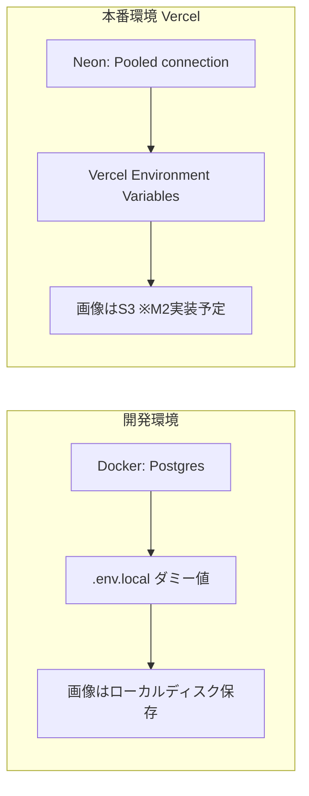

# AGENTS.md

AIコーディングエージェント（Claude Code等）がこのリポジトリで作業する際のルール。
運用ルールの正本は [CONTRIBUTING.md](./CONTRIBUTING.md)。本ファイルはエージェント向けに実務の要点をまとめたもの。

## 絶対禁止事項

- **`main`への直接push・直接コミットは絶対禁止。** 必ず`main`からブランチを切り、PR経由でマージする。
- **Neon（本番DB）への接続・操作はしない。** 開発環境からは本番DBに繋がらない前提で作業する。本番DBでの検証が必要な場合はコード変更やマイグレーション内容をまとめてPMに依頼する（自分で接続情報を探したり繋ぎにいったりしない）。
- `.env` / `.env.local` 等の機密情報（DB接続文字列・S3キー・`NEXTAUTH_SECRET`等）をコミット・ログ出力・コード中への埋め込みをしない。

## 実行コマンド一覧

| コマンド               | 用途                                                                   |
| ---------------------- | ---------------------------------------------------------------------- |
| `bun install`          | 依存パッケージインストール                                             |
| `bun run dev`          | 開発サーバー起動（`localhost:3000`）                                   |
| `bun run build`        | プロダクションビルド                                                   |
| `bun run start`        | ビルド後の起動確認                                                     |
| `bun run lint`         | Biomeによるlint                                                        |
| `bun run format`       | Biomeによる自動整形                                                    |
| `bunx tsc --noEmit`    | 型チェック（専用scriptは未整備のため直接実行）                         |
| `bun run db:generate`  | `src/db/schema.ts`からmigration SQL生成（`drizzle/`配下、git管理対象） |
| `bun run db:migrate`   | 生成済みmigration SQLをDBに反映                                        |
| `bun run db:studio`    | Drizzle Studioでテーブル内容を確認                                     |
| `docker compose up -d` | ローカルPostgres起動                                                   |
| `docker compose ps`    | Postgres起動状態の確認                                                 |
| `docker compose down`  | ローカルPostgres停止                                                   |

テスト用コマンドは現時点でリポジトリに未整備（後述）。

## 作業フロー（CONTRIBUTING.md準拠）

1. `main`から作業ブランチを作成（`git checkout main && git pull && git checkout -b <type>/<description>`）
2. ブランチ名は`<type>/<description>`形式。typeは `feat / fix / docs / style / refactor / perf / test / build / ci / chore` のいずれか（例: `fix/login-error`）
3. 作業・コミット
4. push後、PRを作成してユーザーに提示（ブランチ作成からPR作成まではエージェントが一括で実施してよい）
5. CI・レビュー運用は現状リポジトリの整備状況に合わせる（下記「CONTRIBUTING.mdとのギャップ」を参照）

作業前に必ず最新の[CONTRIBUTING.md](./CONTRIBUTING.md)の内容と齟齬がないか確認すること（ブランチ命名・コミット規約・レビュー要件は更新される可能性がある）。

## 開発環境と本番環境の違い

| 項目                   | 開発                                       | 本番                                                     |
| ---------------------- | ------------------------------------------ | -------------------------------------------------------- |
| DB                     | Docker上のPostgres（`docker-compose.yml`） | Neon（Pooled connection）                                |
| 画像保存               | ローカルディスク                           | S3（M2実装時）                                           |
| `DATABASE_URL`等       | `.env.local`のダミー値                     | Vercel Environment Variables                             |
| `ALLOWED_EMAIL_DOMAIN` | `example.local`                            | 実際の学校ドメイン                                       |
| マイグレーション実行者 | 開発者本人                                 | PM（手元で一時的に本番向けDATABASE_URLに差し替えて実行） |

コード生成・修正時はこの差分を前提にすること。本番固有の値（ドメイン・S3設定等）をハードコードしない、環境によって挙動を分岐させる処理は`process.env`経由で行う。

## 動作検証のルール

- コード変更後は**必ずDocker環境（`docker compose up -d`で起動したPostgres）で動作確認**する。ホストに別途入れたPostgres等での検証は不可（`.env.local`の値と不整合が起きるため）。
- マイグレーションを伴う変更は `bun run db:generate` → `bun run db:migrate` → `bun run db:studio`でテーブル確認、の順で検証する。
- **本番（Neon）での検証はエージェントの作業範囲外。** 本番相当の確認が必要な変更（マイグレーション内容・環境変数追加など）は、検証してほしい内容を明記してPMに依頼する。

## CONTRIBUTING.mdとのギャップ（現状）

- CONTRIBUTING.mdは「CI必須（テストカバレッジ80%以上・セキュリティスキャン等）」を謳っているが、現時点で`.github/workflows`・テストフレームワークは未整備。
- 現状はPRを出す前に`bun run lint` / `bunx tsc --noEmit` / Docker環境での起動確認、を手動チェックとして代替する。
- CI・テストが整備された場合は本セクションと「実行コマンド一覧」を更新すること。

## その他の注意

- `/health`ページ（[src/app/health/page.tsx](./src/app/health/page.tsx)）はDB接続エラーの内容がそのまま表示される検証用ページ。本番公開前に削除または管理者限定にする（未対応なら対応漏れとして指摘する）。
- 画像アップロード関連の`S3_*`環境変数はM2実装までは未使用。該当機能のコードを書く際は本番環境のみで有効になる前提にする。
