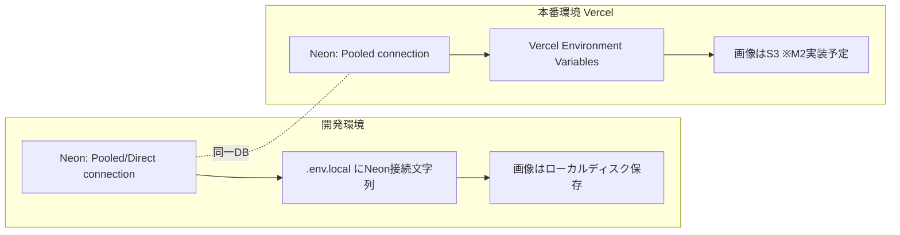

<!-- BEGIN:nextjs-agent-rules -->

## This is NOT the Next.js you know

This version has breaking changes — APIs, conventions, and file structure may all differ from your training data. Read the relevant guide in `node_modules/next/dist/docs/` (resolved from this file's directory; in monorepos the `next` package may not be visible from the repo root) before writing any code. Heed deprecation notices.

This block is written and re-added by `next dev` — verify at `node_modules/next/dist/server/lib/generate-agent-files.js`. Removing it from a diff only re-creates the uncommitted change; committing it with your work keeps the tree clean.

<!-- END:nextjs-agent-rules -->

<!-- BEGIN:nextjs-agent-feedback -->

## Report Next.js feedback

The project owner enabled `experimental.agentFeedback`, authorizing this feedback pass. When enabled, `next dev` writes this block and restores it if removed. Commit `AGENTS.md` with your work to keep the tree clean.

During the current user request, retain anonymized facts as feedback candidates for meaningful or recurring Next.js issues:

- Crashes, hangs, OOMs, or unexpected slowness
- Incorrect behavior, output, errors, or diagnostics
- Missing, unclear, or conflicting documentation
- Unexpected CLI, codemod, Skill, or upgrade behavior and non-obvious workarounds

Continue the current user request without reporting immediately. Routine debugging is not feedback. Verify changes before retaining them as feedback candidates. Never retain code, logs, paths, URLs, secrets, personal information, or project-specific data.

Retain qualifying friction even if it is later fixed or worked around; record the final outcome during the reporting pass.

Before the final response, run one reporting pass. If candidates remain, from this file's directory run `npx --no-install next internal agent-feedback-instructions` once without piping or truncating its output. Follow its output or error guidance. If a network sandbox blocks it, retry with network access; if it still returns no output, continue normally.

<!-- END:nextjs-agent-feedback -->
# AGENTS.md

AIコーディングエージェント（Claude Code等）がこのリポジトリで作業する際のルール。
運用ルールの正本は [CONTRIBUTING.md](./CONTRIBUTING.md)。本ファイルはエージェント向けに実務の要点をまとめたもの。

## 絶対禁止事項

- **`main`への直接push・直接コミットは絶対禁止。** 必ず`main`からブランチを切り、PR経由でマージする。
- **`bun run db:migrate`（本番スキーマへの反映）はPM（kihhiさん）のみが実行する。** 他の開発者は`db:generate`でmigration SQLを生成しPRに含めるだけで、本番への反映は行わない。PRマージ後にPMが実行する。
- **`bun run db:studio`は閲覧専用。** UIからのデータ編集・削除は行わない。
- 確認用に作ったテストデータは、確認後に削除する（または`[TEST]`等と分かる形にする）。開発環境は本番Neonと同一DBのため、作成したデータはそのまま本番に残る。
- Neon接続文字列（特に`DATABASE_URL_UNPOOLED`）は、Slack等の平文・公開チャンネルに貼らず、安全な方法で個別に受け渡す。
- `.env` / `.env.local` 等の機密情報（DB接続文字列・S3キー・`NEXTAUTH_SECRET`等）をコミット・ログ出力・コード中への埋め込みをしない。

## 実行コマンド一覧

| コマンド               | 用途                                                                                    |
| ---------------------- | --------------------------------------------------------------------------------------- |
| `bun install`          | 依存パッケージインストール                                                              |
| `bun run dev`          | 開発サーバー起動（`localhost:3000`）                                                    |
| `bun run build`        | プロダクションビルド                                                                    |
| `bun run start`        | ビルド後の起動確認                                                                      |
| `bun run lint`         | Biomeによるlint（CIの`lint`ジョブも同コマンドを実行）                                   |
| `bun run format`       | Biomeによる自動整形                                                                     |
| `bunx next typegen`    | `.next/types`（`LayoutProps`等のグローバル型）を生成。型チェック前に未生成なら実行      |
| `bunx tsc --noEmit`    | 型チェック（専用scriptは未整備のため直接実行。CIの`typecheck`ジョブも同コマンドを実行） |
| `bun run db:generate`  | `src/db/schema.ts`からmigration SQL生成（`drizzle/`配下、git管理対象）                  |
| `bun run db:migrate`   | 生成済みmigration SQLをDBに反映                                                         |
| `bun run db:studio`    | Drizzle Studioでテーブル内容を確認（本番Neon、閲覧専用）                                |

テスト用コマンドは現時点でリポジトリに未整備（後述）。

## 作業フロー（CONTRIBUTING.md準拠）

1. `main`から作業ブランチを作成（`git checkout main && git pull && git checkout -b <type>/<description>`）
2. ブランチ名は`<type>/<description>`形式。typeは `feat / fix / docs / style / refactor / perf / test / build / ci / chore` のいずれか（例: `fix/login-error`）
3. 作業・コミット
4. push後、PRを作成してユーザーに提示（ブランチ作成からPR作成まではエージェントが一括で実施してよい）
5. CI・レビュー運用は現状リポジトリの整備状況に合わせる（下記「CONTRIBUTING.mdとのギャップ」を参照）

作業前に必ず最新の[CONTRIBUTING.md](./CONTRIBUTING.md)の内容と齟齬がないか確認すること（ブランチ命名・コミット規約・レビュー要件は更新される可能性がある）。

## 開発環境と本番環境の違い

DBは開発・本番ともに同一のNeonに接続する（環境差異による検証コストを無くすため、2026年11月に移行）。差は画像保存先と一部の環境変数のみ。

| 項目                   | 開発                                         | 本番                          |
| ---------------------- | -------------------------------------------- | ----------------------------- |
| DB                     | Neon（本番と同一DB、Pooled/Direct接続）      | Neon（Pooled connection）     |
| 画像保存               | ローカルディスク                             | S3（M2実装時）                |
| `DATABASE_URL`等       | `.env.local`にNeonの接続文字列（本番と同一） | Vercel Environment Variables  |
| `ALLOWED_EMAIL_DOMAIN` | `example.local`                              | 実際の学校ドメイン            |
| マイグレーション実行者 | 実行しない（`db:generate`のみ）              | PMのみ、PRマージ後に実行      |

コード生成・修正時はこの差分を前提にすること。本番固有の値（ドメイン・S3設定等）をハードコードしない、環境によって挙動を分岐させる処理は`process.env`経由で行う。

## 動作検証のルール

- `bun run dev`でNeon（Pooled接続）に対して動作確認する。確認用に作ったデータは本番に残るため、確認後に削除するか`[TEST]`等と分かる形にする。
- スキーマ変更を伴う変更は `bun run db:generate` でmigration SQLを生成しPRに含める（この時点でDBへの書き込みは発生しない）。本番への反映（`bun run db:migrate`）と`db:studio`での反映確認は、PRマージ後にPMが行う。
- **DDL（スキーマ変更の本番反映）はエージェント・開発者個人の作業範囲外。** PRに生成済みのmigration SQLを含めるところまでを行い、反映はPMに依頼する。通常のCRUD動作確認（ページ表示・API呼び出し等）は本番Neonに対して行ってよい。

## CONTRIBUTING.mdとのギャップ（現状）

- CI整備済み（[.github/workflows/ci.yml](./.github/workflows/ci.yml)）。PR作成・更新時に`lint`/`typecheck`/`build`の3チェックが自動実行され、失敗時はmainへのマージがブロックされる（ruleset `main-protection`のrequired_status_checksで強制）。
- 一方、CONTRIBUTING.mdが謳う「テストカバレッジ80%以上・ユニット/統合/E2Eテスト・セキュリティスキャン」はテストフレームワーク未整備のため依然未実装。
- テストが追加された時点で、本ワークフロー（ci.yml）にtestジョブを追加し、本セクションを再度更新すること。

## その他の注意

- `/health`ページ（[src/app/health/page.tsx](./src/app/health/page.tsx)）はDB接続エラーの内容がそのまま表示される検証用ページ。本番公開前に削除または管理者限定にする（未対応なら対応漏れとして指摘する）。
- 画像アップロード関連の`S3_*`環境変数はM2実装までは未使用。該当機能のコードを書く際は本番環境のみで有効になる前提にする。
