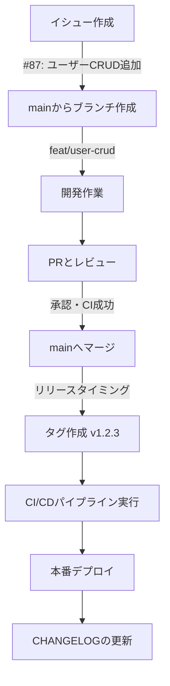
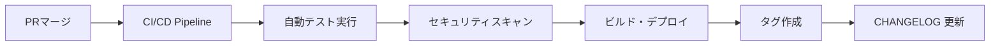

# Contributing to team-a

このガイドラインは、効率的なブランチ管理とチーム開発のためのルールを定めています。

## 作業の流れ

### 1. イシューの作成

[イシューテンプレート](./.github/ISSUE_TEMPLATE/default.md)に従って作成

### 2. ブランチの作成

ブランチ命名規則（[#ブランチ命名規則](#ブランチ命名規則)）に準拠し、`main`から作成

### 3. 開発作業

- ローカルで作業を実施
- 定期的にコミット

### 4. コミット＆プッシュ

[コミットメッセージ規約](#)に従う

### 5. プルリクエスト

- 新規PR作成時は[PRテンプレート](./.github/PULL_REQUEST_TEMPLATE.md)が自動で適用されます
- バグ修正の場合は、PR作成URLに`?template=bugfix_pr.md`を付けて[バグ修正用テンプレート](./.github/PULL_REQUEST_TEMPLATE/bugfix_pr.md)を使ってください
- [レビューガイドライン](./.github/PULL_REQUEST_TEMPLATE/review_template.md)を参考にレビューを依頼

### 6. コードレビュー

建設的なレビューを実施

### 7. マージ

- レビュー承認・CI 成功後に`main`へマージ
- ブランチのクリーンアップ

### 8. リリース（必要なタイミングで）

- `main`上の任意のコミットにタグを付けてリリース

## メインブランチの保護

### 重要なルール

- **main ブランチへの直接プッシュは禁止**
  - リポジトリの安定性を保つため
  - 緊急時の復旧を容易にするため
- **main は常にリリース可能な状態を維持する**
  - 未完成の機能は Feature Flag などで隠す
  - CI が通った PR のみマージ可能

### 推奨される作業フロー

1. イシューに関連する作業用ブランチを`main`から作成
2. 作業用ブランチで開発を実施
3. PR 作成・レビュー・CI 通過後に`main`へマージ
4. 必要なタイミングでタグを作成し、CI/CD で本番デプロイ

## ブランチ命名規則

### 基本フォーマット

```md
<type>/<description>
```

### Type 一覧

| Type     | 説明                 | 例                         |
| -------- | -------------------- | -------------------------- |
| feat     | 新機能の追加         | feat/add-user-registration |
| fix      | バグ修正             | fix/login-error            |
| docs     | ドキュメントの更新   | docs/update-readme         |
| style    | コードスタイルの修正 | style/fix-indentation      |
| refactor | リファクタリング     | refactor/auth-process      |
| perf     | パフォーマンス改善   | perf/optimize-query        |
| test     | テストの追加・修正   | test/add-user-tests        |
| build    | ビルドシステムの変更 | build/update-dockerfile    |
| ci       | CI 関連の変更        | ci/github-actions          |
| chore    | その他の変更         | chore/update-dependencies  |

### 命名のルール

#### 1. 区切り文字

- Type と説明の間: `/`
- 説明の単語間: `-`

#### 2. 説明部分のルール

- 英語の小文字のみ使用
- 単語間は `-` で区切る
- 簡潔で分かりやすい説明
- 50 文字以内を推奨
- 必要に応じてイシュー番号を含める

### 良い例

```md
feat/add-user-authentication
fix/resolve-login-error
docs/update-api-docs
feat/auth-system-issue-123
```

### 悪い例

```markdown
feature_add_authentication # 不適切な区切り文字
fix-login # Type の後のスラッシュがない
ADD-USER # 大文字使用、Type 不明
feat/Add_User # 不適切な区切り文字と大文字
```

## ブランチワークフロー例



## ブランチ戦略詳細

### ブランチ構成

| ブランチ名 | 用途 | 保護レベル |
| --- | --- | --- |
| `main` | 開発統合・本番環境を兼ねる。常にリリース可能な状態を維持 | 🔒 最高 |

### ブランチ運用ルール

#### 1. 開発ブランチ（Feature/Fix ブランチ）

- **作成元**: 必ず`main`ブランチから作成
- **命名規則**: `<type>/<description>` （例: `feat/user-authentication`）
- **マージ先**: `main`ブランチのみ
- **ライフサイクル**: 機能完成後に削除

```bash
# 開発ブランチの作成例
git checkout main
git pull origin main
git checkout -b feat/user-authentication
```

#### 2. main ブランチ

- **用途**: 開発統合・本番環境の両方を兼ねる
- **更新頻度**: PR マージごと
- **テスト**: PR ごとに CI で自動テスト・品質チェックを実施
- **リリース**: マージ時に自動デプロイ、またはタグ作成時にリリース（プロジェクトの要件に応じて選択）

## CI/CD パイプライン

### リリースフロー



### CI/CD 必須要件

#### 1. 自動テスト

- **ユニットテスト**: 全テストが成功すること
- **統合テスト**: API テストが成功すること
- **E2E テスト**: 主要ユーザーフローが正常動作すること
- **テストカバレッジ**: 80% 以上を維持すること

#### 2. セキュリティチェック

- **依存関係スキャン**: 脆弱性のある依存関係がないこと
- **静的解析**: セキュリティ上の問題がないこと
- **シークレット検出**: ハードコードされた機密情報がないこと

#### 3. 品質チェック

- **Lint チェック**: コードスタイルガイドラインに準拠すること
- **型チェック**: TypeScript の型エラーがないこと
- **パフォーマンステスト**: 性能劣化がないこと

### バージョン管理とリリース

#### 1. バージョニング

- **Semantic Versioning** を採用
- **MAJOR.MINOR.PATCH** 形式（例: 1.2.3）
- **Breaking Changes**: MAJOR バージョンアップ
- **新機能**: MINOR バージョンアップ
- **バグ修正**: PATCH バージョンアップ

#### 2. リリース手順

```bash
# 1. mainブランチが最新であることを確認
git checkout main
git pull origin main

# 2. タグの作成（これがリリースのトリガーになる）
git tag v1.2.3
git push origin v1.2.3

# 3. CI/CDパイプラインが自動実行され、本番デプロイ
# GitHub Actions で自動実行される

# 4. CHANGELOGの更新
# CHANGELOG.md を編集
git add CHANGELOG.md
git commit -m "docs: update CHANGELOG for v1.2.3"
git push origin main
```

#### 3. CHANGELOG 更新ルール

- **リリース後**: タグ作成後に必ず更新（release-drafter 等での自動生成も検討可）
- **フォーマット**: [Keep a Changelog](https://keepachangelog.com/ja/1.0.0/) に準拠
- **内容**: 追加・変更・修正・削除・セキュリティの分類で記載
- **リンク**: GitHub リリースページへのリンクを追加

例：

```markdown
## [1.2.3] - 2024-02-15

### 追加

- ユーザー認証機能を追加 (#123)
- パスワードリセット機能を実装 (#124)

### 修正

- ログイン時のメモリリークを修正 (#128)
- モバイル表示の崩れを修正 (#129)

### セキュリティ

- JWT トークンの有効期限を短縮 (#130)
```

## 👥 レビュープロセス

### レビュワー

PR には **1〜2 名のレビュー承認** が必要です（CODEOWNERS で該当領域のレビュワーを自動アサイン）。

### レビュー要件

| 変更の種類 | 必要レビュワー数 | 追加要件 |
| --- | --- | --- |
| 通常の機能追加・修正 | 1 名以上 | 基本的なコードレビュー |
| 重要な変更（認証・DB・インフラ等） | 2 名以上 | 設計・影響範囲の確認 |
| すべての PR 共通 | - | CI の全チェック成功が必須 |
