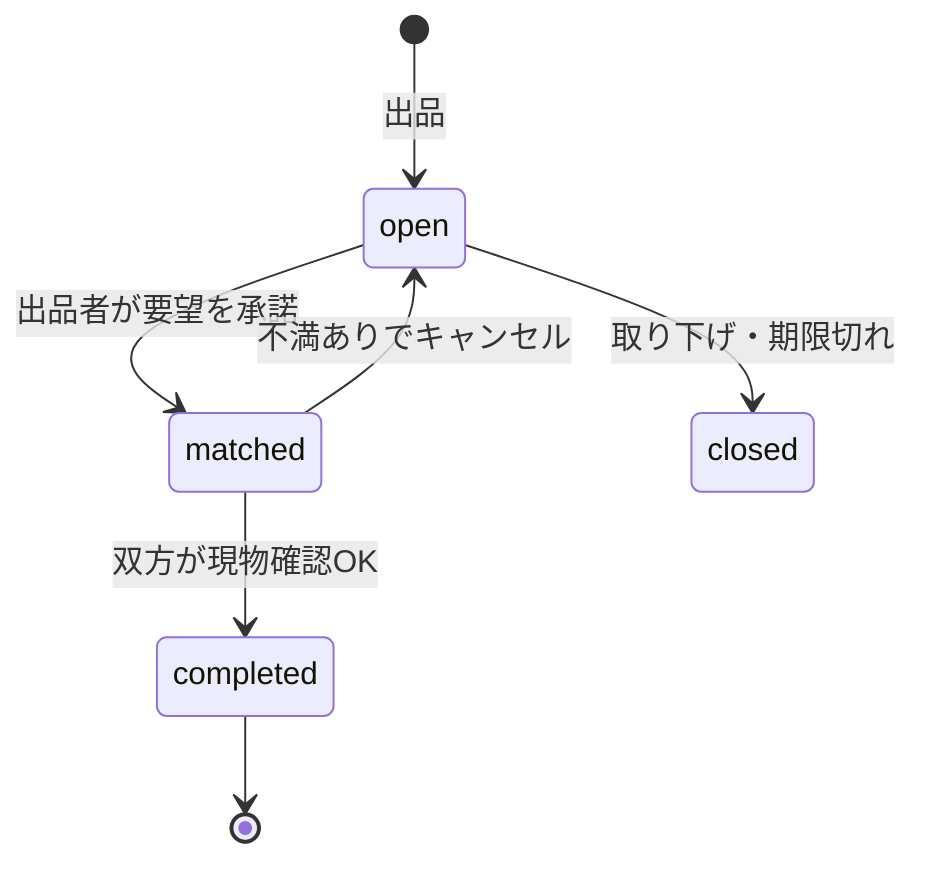

結論：要望書のたたき台、作れたよ！決まってない所は **⚠️仮** って印を付けたから、最後に大事な質問を1つだけさせてね。

---

# SIW物々交換所（仮） 機能検討 要望書

## 1. アプリケーションの概要・コンセプト
さいたまITWEB専門学校（SIW）の学生だけが使える、「いらない物」と「欲しい物」をセットで公開し、学内で手渡しして物々交換できるWebアプリ。
この案を選んだ理由は、お金も配送も使わず、同じ学校の人同士なら現物を直接見て確かめられるので、フリマアプリより安心で気軽に交換できると考えたため。

## 2. 解決する課題とターゲットユーザー
- **対象ユーザー：** SIWの在校生。進級・卒業・引っ越し前に物が余る人や、教科書・機材・グッズを買わずに手に入れたい人。
- **解決するペインポイント：**
  - フリマアプリは手数料・発送・不特定多数の相手が面倒で不安
  - 学内の掲示や口頭では、必要な人に情報が届かない
  - 「これが欲しい」があっても、持っている人と出会えない
- **提供する独自の価値（ベネフィット）：**
  - 学内限定＋手渡し前提（発送なし・手数料なし）
  - 出品者が「欲しい物」も出せる、双方向の交換
  - 複数の要望の中から出品者が選べる
  - 現物確認で不満があればキャンセルできる安心感
  - 成立前は公開コメント、成立後は2人だけのDM

## 3. 動作・作業環境（半角英数字のみ）
- **ドキュメントルート（フォルダ名）：** / siw-barter /
- **データベース名（仮）：** siw_barter

## 4. 実装機能一覧
> 用語：**出品**＝いらない物の公開／**要望**＝出品に対する「これと交換したい」の申し込み／**成立**＝出品者が要望を承諾した状態／**完了**＝現物確認が済んだ状態

### ① 必須機能（コアとなる体験・最低限必要な機能）
- [ ] 会員登録・ログイン：メールアドレス＋パスワード。⚠️仮：学内限定の確認は「学校で配る招待コード」方式
- [ ] 出品：タイトル・説明・カテゴリ・画像（最大3枚 ⚠️仮）・受け渡し希望（場所／時間帯）
- [ ] 商品の状態の入力：5段階（新品同様／良好／使用感あり／傷・汚れあり／ジャンク）＋補足コメント
- [ ] 「欲しい物」の登録：出品時に、交換してほしい物（カテゴリ＋自由記述）を任意で入力
- [ ] 一覧・検索・絞り込み：キーワード／カテゴリ／状態／「欲しい物」で検索
- [ ] 要望の送信：他の学生が出品を見て、差し出す物（自分の出品物 or 自由記述 ⚠️仮）とメッセージを添えて申し込む
- [ ] 要望の選択・承諾：出品者が届いた要望から1つ選んで承諾。他の要望には自動で「見送り」を通知
- [ ] 公開コメント：成立前は出品ページ上で誰でも見られる質問・やりとり
- [ ] 2人専用DM：成立後は、成立した2人だけが閲覧・送信できる（受け渡しの日時・場所の調整）
- [ ] 現物確認とキャンセル：受け渡し時に双方が現物を確認し、「OK」か「不満あり（理由必須）」を選ぶ。双方OKで「完了」。どちらかが不満ありならキャンセルとなり、出品は「公開中」に戻る
- [ ] マイページ：自分の出品／送った要望／受けた要望／進行中の交換／履歴

### ② 付加価値・トレンド機能（さらに面白く・使いやすくする機能）
- [ ] 欲しい物マッチ通知：自分の出品が誰かの「欲しい物」に合うと知らせる
- [ ] ウォッチ（お気に入り）：気になる出品を保存
- [ ] 出品の有効期限：卒業や長期休み前に自動で非公開化
- [ ] 信頼バッジ：交換完了数・キャンセル率を表示
- [ ] 通報機能：不適切な出品やコメントを運営に報告
- [ ] 受け渡し場所プルダウン：学内の決まった場所から選ぶ
- [ ] 「譲ります」モード：欲しい物なしで出品

### ③ 実務・セキュリティ要件（安全な運用のための必須要件）
- [ ] パスワード暗号化：ハッシュ化（パスワードハッシュ関数）による安全なDB保存
- [ ] 脆弱性対策：SQLインジェクション（パラメータ化クエリ）、XSS（出力エスケープ）、CSRF（SameSite Cookie＋トークン）への基本対策
- [ ] 認可チェック：DMは当事者のみ、出品の編集・承諾は出品者のみ。IDを書き換えても他人のデータに触れない
- [ ] 画像アップロード制限：形式とサイズの制限
- [ ] 取引禁止物のルール明記：現金・金券・危険物・酒・タバコ・偽物など

## 5. 次のステップ（シニアエンジニアからのアドバイス）

**出品の状態遷移（案）**

**テーブル案（たたき台）**

| テーブル | 主なカラム | 役割 |
|---|---|---|
| users | id, email, password_hash, nickname, created_at | 会員 |
| items | id, owner_id, title, description, category, condition, wanted_text, wanted_category, pickup_note, status, expires_at | 出品と欲しい物 |
| item_images | id, item_id, url, sort_order | 出品画像 |
| offers | id, item_id, requester_id, offered_item_id(NULL可), message, status | 要望 |
| comments | id, item_id, user_id, body, created_at | 成立前の公開コメント |
| trades | id, item_id, offer_id, owner_id, requester_id, owner_check, requester_check, cancel_reason, status | 成立後の取引と現物確認 |
| messages | id, trade_id, sender_id, body, created_at | 成立後の2人DM |

**アドバイスと懸念点**
- 物々交換の最大の壁は、経済学者ジェヴォンズ（1875年）が「欲求の二重の一致」と呼んだ問題。自分の欲しい物を相手が持っていて、しかも相手も自分の物を欲しがる必要がある。このアプリは「欲しい物」を出させて要望を集めることで、この壁を下げている。ここが独自性の核になる
- 懸念：同じ出品に同時に承諾が走る「二重成立」。トランザクションと「statusがopenの時だけ更新する」条件付きUPDATEで防ぐ。トランザクションは1970〜80年代にジム・グレイらが体系化した、DBの基本
- 懸念：NeonはDBなので画像は置けない。Vercel Blobなどの外部ストレージに保存して、DBにはURLだけ入れる
- 懸念：学内限定の確認方法。招待コードが現実的だけど、運用面は先生に相談しておくと安心
- 懸念：要望に差し出した自分の物が、別の交換にも使われる場合の扱い（片方が成立したら他は自動で失効させる）
- 開発順のおすすめ：認証 → 出品 → 一覧 → 要望 → 承諾 → DM → 現物確認／キャンセル。状態遷移・認可・トランザクションが全部入りなので、実習として学べることが多くて強い

---

📌 学生へのメッセージ
1. この要望書をコピーして、プロジェクト直下に `01_proposal.md` というファイル名でVSCode等に保存してください。
2. エラー防止のため、ドキュメントルートのフォルダ名やDB名は【半角英数字（ハイフン・アンダースコア可）】のみを使用してください。

---

じゃあ質問、1つだけ。**要望を出す人は、必ず「自分の持ち物（出品中の物）」を差し出す形にする？ それとも「これと交換したい」って言葉で書くだけでもOKにする？**

私のおすすめは「どっちもOK」。出品物を選べば現物のイメージが伝わるし、まだ出品してない人も参加できるよ。ここが決まるとテーブル（offers）がピタッと確定するよ〜✨

（現在のラリー数: 6/15）
