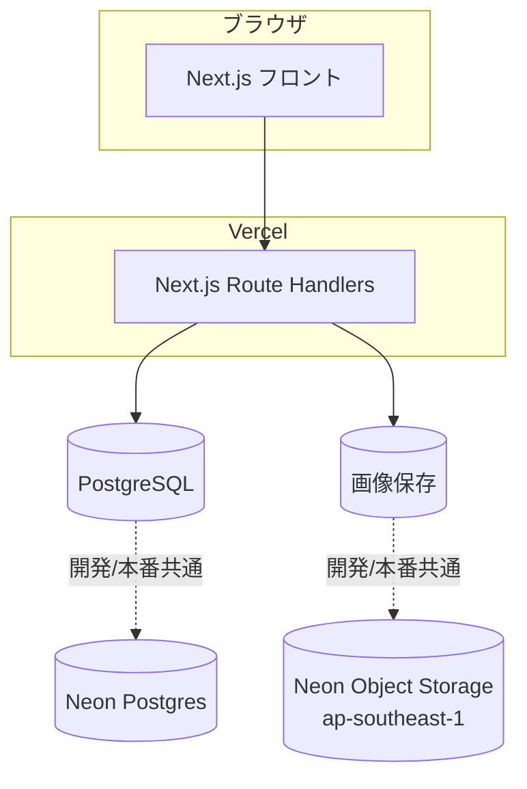
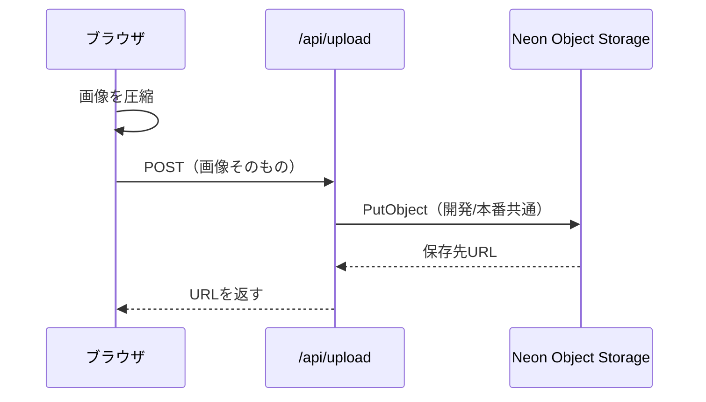

# SIW物々交換所（仮） 技術定義書

対象読者：開発メンバー全員。実装前に全員が同じ構成を見れるようにするための定義書。

## 1. 結論（技術スタック）

| 領域 | 選定 | 理由 |
|---|---|---|
| フレームワーク | **Next.js (App Router) + TypeScript** | フロント／API(Route Handlers)が1プロジェクトで完結。Vercelデプロイと相性が良い |
| DB（開発） | **Neon（本番と同一DB、Pooled/Direct接続）** | 本番と完全に同一の環境にすることで環境差異による検証コストを無くす（2026年11月〜） |
| DB（本番） | **Neon（Serverless Postgres）** | 既定どおり |
| ORM | **Drizzle** | SQLに近い書き方で学習コストが低い。`drizzle-kit`でマイグレーション管理、Neonとの接続実績も多い |
| 画像保存 | **開発・本番共通: Neon Object Storage**（S3互換） | 常に自分のAPI（`/api/upload`）経由でアップロードし、サーバー側で`PutObject`する。ブラウザ側のコードは開発/本番で完全に同一（保存先の振り分け自体が不要）。画像用S3互換Dockerイメージ(MinIO)の配布が2026年9月頃から不安定になったため、DBと同様の理由でDockerに依存せず開発環境もNeon Object Storageに直結する方式にした。DBにはURLのみ保存（方針はproposalのまま） |
| 認証 | **Auth.js (NextAuth) Credentials Provider** | セッション管理はAuth.jsに任せる。学籍番号チェックはフロント（UX用）とサーバー（必須）の両方で同じ判定関数を使う。メール確認リンクは実装しない（なりすましリスクは管理者の無効化機能で対応） |
| バリデーション | **zod** | フォーム入力・API入力の型安全なチェックに使う |
| デプロイ | **Vercel**（Production / Preview） | 既定どおり |
| CI | **GitHub Actions**（lint / typecheck / build） | 4人以上での並行開発なので、マージ前の最低限の自動チェックを入れる |

> 認証・バリデーションのライブラリは後から変更しても大きな手戻りはないので、まずはこの構成で進めてOK。

## 2. 全体構成図



## 3. 環境変数一覧

DB・画像ストレージ接続は本番と共通（2026年11月〜、環境差異解消のため開発環境もNeon本番DB・Neon Object Storageに直結）。他の環境変数（`ALLOWED_EMAIL_DOMAIN`等）は引き続き開発用ダミー値を使う。Neonの接続文字列・`S3_PUBLIC_BASE_URL`はPM/Vercelの環境変数設定だけでなく、開発者の`.env.local`にも入る（受け渡しは安全な方法で行う）。

| 変数名 | 用途 | 開発時の値 | 本番時の値（PM/Vercelのみ） |
|---|---|---|---|
| `DATABASE_URL` | Drizzle(postgres-js)接続先 | Neonの接続文字列（Pooled） | Neonの接続文字列（Pooled） |
| `DATABASE_URL_UNPOOLED` | drizzle-kit（generate/migrate/studio）用 | Neonの接続文字列（Direct） | PMのみが保持（Direct） |
| `S3_PUBLIC_BASE_URL` | 保存した画像の公開URLのベース（読み取り専用・GETのみ） | 本番と共通の値 | 本番と共通の値 |
| `ALLOWED_EMAIL_DOMAIN` | 学内メールドメイン判定 | 検証用ダミー値（例: `example.local`） | 実際の学校ドメイン |
| `NEXTAUTH_SECRET` | Auth.jsセッション署名鍵 | 適当なダミー文字列でOK | 本番用ランダム値（厳重管理） |
| `NEXTAUTH_URL` | Auth.jsのベースURL | `http://localhost:3000` | 本番URL |

画像アップロード機能（M2）本体が使う書き込み用の認証情報（`PutObject`用）はまだ発行していない。実装時に変数名も含めてPMから別途共有する。

`.env.example`はプレースホルダのみ。実際の値はPMから安全な方法（パスワードマネージャー等）で個別に受け取り、`.env.local`に設定する。`.env.local`はgitignore対象。

### `.env.local`（開発用）の例

```env
DATABASE_URL=postgresql://<user>:<password>@<project-id>-pooler.<region>.aws.neon.tech/<dbname>?sslmode=require
DATABASE_URL_UNPOOLED=postgresql://<user>:<password>@<project-id>.<region>.aws.neon.tech/<dbname>?sslmode=require
S3_PUBLIC_BASE_URL=https://<branch-id>.storage.c-<n>.<region>.aws.neon.tech/<bucket-name>
ALLOWED_EMAIL_DOMAIN=example.local
NEXTAUTH_SECRET=dev-secret-anything
NEXTAUTH_URL=http://localhost:3000
```

実際の値（上記の`<...>`部分）はPMから受け取る。`.env.example`にはこの形のプレースホルダのみコミットする（本番の秘密情報は含めない）。

## 4. 学内限定チェック

[01_proposal.md](01_proposal.md)の判定ロジック（`siw`＋学籍番号`00`-`45`＋学校ドメイン）をそのまま使う。同じ判定関数をフロント（登録フォームの即時エラー表示用）とサーバー（API側の必須チェック）の両方から呼ぶ。フロントのチェックはUX向上のためで、実際の制限はサーバー側のみで担保する。

なりすまし登録（他人の学籍番号メールで先に登録される）リスクは、proposal記載どおり**管理者による無効化機能で対応**し、メール確認リンクは実装しない。

## 5. 画像アップロード（常に自分のAPI経由／開発・本番共通でNeon Object Storage）

画像用のS3互換Dockerイメージ（MinIO）は2026年9月頃からDocker Hub・quay.ioともに配布が不安定になり、再発の可能性もあるため、DBと同様の理由で**開発環境もDockerに依存せず直接Neon Object Storageに接続する**方式にした。また、開発/本番の手順差をブラウザ側に持たせないよう、**ブラウザは常に自分のAPI（`/api/upload`）に画像をPOSTする**設計にする（presigned URLでブラウザから直接ストレージにPUTする方式は採らない）。



- **ブラウザ側のコードは開発/本番で完全に同一**（常に`/api/upload`にPOSTするだけ）
- `src/lib/image-storage.ts`も環境分岐なしで`@aws-sdk/client-s3`の`PutObject`を直接呼ぶだけ（開発/本番で同じNeon Object Storageバケットに保存。presigned URLや直PUT用のCORS設定は不要）
- バケットの公開設定（`public_read`）はS3 APIではなく**Neonコンソール/API側**で行う（`PutBucketAcl`は未サポート）
- 既知の制限（Neon側）：バケット通知(SNS/SQS)なし、バージョニング/ライフサイクルは保存されるが効果なし。今回の用途（画像保存のみ）では影響しない
- 画像はVercelの関数を経由する（ブラウザ側で圧縮済みのため、1枚あたり数百KB〜1MB程度・最大3枚を想定。Vercelのデフォルトのリクエストボディ上限に余裕で収まる）
- DBと同じ単一バケットを開発/本番で共有するため、確認用にアップロードした画像も本番に残る。確認後は削除するか`[TEST]`等と分かる名前にする（DBの確認用データと同じ運用）

## 6. 開発〜本番のフロー

```mermaid
flowchart LR
    dev[ローカル開発\nNeon直結(Pooled)] --> pr[PR作成]
    pr --> preview[Vercel Preview Deploy]
    pr --> merge[mainにmerge]
    merge --> migrate[PMがdb:migrateで\n本番スキーマ反映]
    merge --> prod[Vercel Production]
    migrate --> neon[(Neon Production DB)]
    prod --> neon
```

### PR最終確認（開発環境も本番Neonに常時接続）について

**結論：今の規模（学内・小人数・無料枠）なら、このやり方で進めてOK。** 開発環境と本番環境の差異による検証コストが大きくなったため、2026年11月に「開発者個人が一時的に.envを差し替える」運用から「開発環境も常時本番Neonに接続する」運用に変更した。以下の4点は最初から徹底する。

1. `.env`・`.env.local` は必ず `.gitignore` に入れる（本番シークレットの誤コミット防止）
2. Drizzleのマイグレーション（スキーマ変更時に`drizzle-kit generate`で出るSQL）は必ずPRレビュー対象にする。本番DBに当てる前に内容を確認する
3. 本番DBに直接書き込む確認作業なので、確認用データは確認後に消す（または「テスト用」と分かるデータにする）運用ルールをPRテンプレートに書いておく
4. 開発者個人は`bun run db:migrate`を実行しない。本番への反映はPM（kihhiさん）のみが、PRマージ後に行う

**検討した代替案：** Neonは無料枠でも「ブランチ機能」でDBのクローンを作れるため、本番ブランチをコピーした検証用ブランチで確認する案も検討した。運用がシンプルになる一方、開発/検証環境と本番のブランチが分かれることで再び環境差異が生まれるため、**ブランチ機能は使わず、全開発者が単一の本番Neon DBに直結する方針に決定した**（上記①〜④のルール運用でリスクを抑える）。

## 7. ディレクトリ構成（初期）

```
siw-barter/
├─ drizzle/            # drizzle-kitが生成するマイグレーションSQL
├─ drizzle.config.ts
├─ src/
│  ├─ app/            # Next.js App Router（画面・API）
│  ├─ db/
│  │  └─ schema.ts    # Drizzleのテーブル定義
│  ├─ lib/            # auth, validation 等の共通処理
│  └─ components/
├─ .env.example
└─ 01_proposal.md, 02_tech_spec.md, 03_milestones.md
```

## 8. テーブル定義

[01_proposal.md](01_proposal.md) 内の「テーブル案」をそのまま採用。変更があれば本ドキュメントではなくproposal側を更新し、ここでは参照のみとする。
