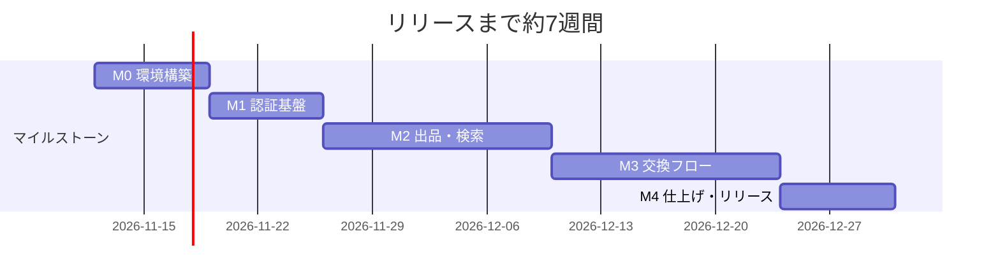

# SIW物々交換所（仮） マイルストーン & Issue候補

前提：開発メンバー4人以上、リリース目安は約7週間。技術構成は [02_tech_spec.md](02_tech_spec.md) を参照。

## マイルストーン概要

| マイルストーン | 期間目安 | ゴール |
|---|---|---|
| M0: 環境構築 | Week1 | 開発環境・インフラの疎通確認 |
| M1: 認証基盤 | Week2 | 会員登録・ログイン・DBスキーマ |
| M2: 出品・検索 | Week3-4 | 出品・画像・一覧検索・要望送信 |
| M3: 交換フロー | Week5-6 | 承諾・コメント・DM・現物確認・マイページ |
| M4: 仕上げ | Week7 | セキュリティ総点検・管理者機能・QA・リリース |

> 日付は目安。実際のキックオフ日に合わせてスライドしてOK。②付加価値機能（通知・ウォッチ等）は最後に余力があれば着手する「ストレッチ」扱い。

---

## M0: 環境構築（Week1）

- [x] [Infra] Next.js(App Router) + TypeScriptプロジェクト作成（Biomeでlint/format設定済み）
- [x] [Infra] Docker ComposeでローカルPostgres構築（画像のローカル保存はDocker不要なのでMinIOは使わない。経緯は[02_tech_spec.md](02_tech_spec.md)5章）
- [x] [DB] Drizzle導入、[05_db_design.md](05_db_design.md)の設計（完成形）でスキーマ化（drizzle-kit）
- [x] [Infra] `.env.example`作成、[04_setup.md](04_setup.md)にセットアップ手順を記載（クローン後に本番の値を一切入れずに起動できることを確認）
- [ ] [Infra] Neon本番プロジェクト作成・接続確認（開発者個人の.env.localには入れない。PM/Infra担当のみ扱う）
- [ ] [Infra] Vercelプロジェクト作成、デプロイ確認、環境変数登録（本番用はVercel側にのみ登録）
- [ ] [Infra] Neon Object Storage（本番用バケット）の作成・CORS設定・public_read設定・アップロード動作確認
- [ ] [Infra] GitHub Actionsでlint/typecheck/buildのCI設定

## M1: 認証基盤（Week2）

- [ ] [BE] usersテーブルのDrizzleスキーマ定義・マイグレーション
- [ ] [BE][FE] 学内メール形式チェック関数（`siw230100`＋`01`-`40`＋ドメイン）を共通化し、フロント（即時エラー表示）とサーバー（必須チェック・小文字化）の両方から呼ぶ
- [ ] [BE] パスワードハッシュ化（bcrypt等）＋会員登録API
- [ ] [FE] 会員登録画面
- [ ] [BE] Auth.js Credentials Providerでログイン機能
- [ ] [FE] ログイン画面
- [ ] [BE] ログイン試行回数制限（レートリミット）
- [ ] [BE] 認可ミドルウェア基盤（未ログイン時リダイレクト、role判定の土台）
- [ ] [FE] マイページ雛形（ログインユーザー情報のみ）

## M2: 出品・検索（Week3-4）

- [ ] [DB] items / item_images テーブル作成
- [ ] [BE] 出品作成API（タイトル・説明・カテゴリ・状態・欲しい物）
- [ ] [FE] 出品作成画面
- [ ] [BE] 画像アップロードAPI（`/api/upload`。ブラウザは常にここにPOST、`STORAGE_DRIVER`でサーバー側だけ開発=ローカルディスク／本番=Neon Object Storageに振り分け。最大3枚、形式/サイズ制限）
- [ ] [FE] ブラウザ側での画像圧縮
- [ ] [FE] 出品一覧・詳細ページ
- [ ] [BE] キーワード/カテゴリ/状態/欲しい物での検索・絞り込みAPI
- [ ] [DB] offers / offer_images テーブル作成
- [ ] [BE][FE] 要望送信機能（出品済みでなくてもOK、出品と同項目＋メッセージ）

## M3: 交換フロー（Week5-6）

- [ ] [BE][FE] 出品者向け：届いた要望一覧・選択・承諾
- [ ] [BE] 承諾時に他要望を自動「見送り」にする処理
- [ ] [BE] 二重成立防止（トランザクション＋`status=open`条件付きUPDATE）
- [ ] [BE][FE] 公開コメント機能（成立前のみ表示・投稿）
- [ ] [DB] trades / messages テーブル作成
- [ ] [BE][FE] 成立後の2人専用DM
- [ ] [BE][FE] 現物確認フロー（OK／不満あり＋理由、双方OKで完了、片方不満でキャンセル→出品を公開中に戻す）
- [ ] [FE] マイページ拡充（出品／送った要望／受けた要望／進行中／履歴）

## M4: 仕上げ・セキュリティ・リリース（Week7）

- [ ] [Sec] 認可チェック総点検（DM・編集・承諾などIDなりすまし対策）
- [ ] [Sec] XSS対策確認（出力エスケープ）
- [ ] [Sec] CSRF対策確認（SameSite Cookie＋トークン）
- [ ] [Sec] SQLインジェクション対策確認（Drizzleのパラメータ化を前提に念のため確認）
- [ ] [Sec] メールアドレス非表示（ニックネームのみ表示）の確認
- [ ] [BE][FE] 管理者機能（アカウント無効化、出品・コメント削除）
- [ ] [Doc] 取引禁止物のルール明記（ガイドラインページ）
- [ ] [QA] 結合テスト・バグ修正
- [ ] [Infra] 本番Neon・Vercel本番環境の最終確認、リリース

## ストレッチ（時間が余ったら／②付加価値機能）

- [ ] メール確認リンク（なりすまし登録対策の本命）
- [ ] 欲しい物マッチ通知
- [ ] ウォッチ（お気に入り）
- [ ] 出品の有効期限（自動非公開化）
- [ ] 信頼バッジ
- [ ] 通報機能
- [ ] 受け渡し場所プルダウン
- [ ] 「譲ります」モード

---

### ラベルの意味

`[Infra]`環境構築 `[DB]`テーブル/マイグレーション `[BE]`API/サーバー処理 `[FE]`画面 `[Sec]`セキュリティ `[QA]`テスト `[Doc]`ドキュメント
