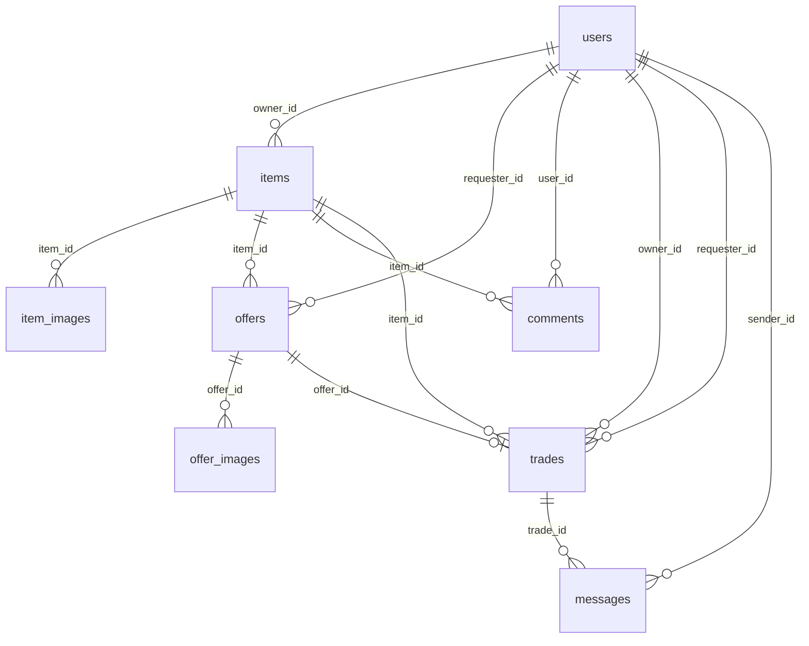
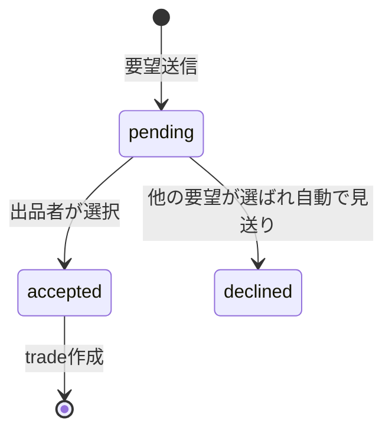
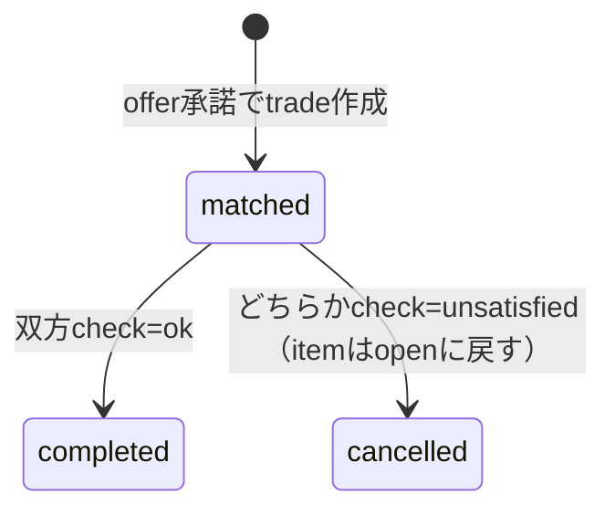

# SIW物々交換所（仮） データベース設計（完成形）

対象読者：開発メンバー全員。①必須機能に必要なテーブルを**最初から完成形**で設計したもの。以後はこの設計をベースにして、必要な時だけ追加・調整するスタイルで進める（毎回ゼロから設計し直さない）。

元になった仕様は [01_proposal.md](01_proposal.md)。実装は[src/db/schema.ts](../src/db/schema.ts)（この設計どおりに更新済み）。

## 1. 全体ER図



## 2. テーブル定義

### users（会員）

| カラム | 型 | 制約 | 備考 |
|---|---|---|---|
| id | serial | PK | |
| email | varchar(255) | NOT NULL, UNIQUE | **保存・比較の前に必ず小文字化する（アプリ側の責務）** |
| password_hash | text | NOT NULL | |
| nickname | varchar(50) | NOT NULL | 他ユーザーに表示する名前（emailは非表示） |
| role | enum `role` | NOT NULL, default `user` | `user` \| `admin` |
| is_active | boolean | NOT NULL, default `true` | 管理者が無効化すると`false` |
| created_at | timestamp | NOT NULL, default now() | |

### items（出品）

| カラム | 型 | 制約 | 備考 |
|---|---|---|---|
| id | serial | PK | |
| owner_id | integer | FK→users.id, NOT NULL | |
| title | varchar(100) | NOT NULL | |
| description | text | NOT NULL | |
| category | varchar(50) | NOT NULL, index | 検索・絞り込みに使う |
| condition | enum `item_condition` | NOT NULL | 5段階 |
| wanted_text | text | NULL可 | 欲しい物の自由記述 |
| wanted_category | varchar(50) | NULL可 | 欲しい物のカテゴリ |
| pickup_note | text | NULL可 | 受け渡し希望（場所／時間帯） |
| status | enum `item_status` | NOT NULL, default `open`, index | `open`\|`matched`\|`completed`\|`closed` |
| expires_at | timestamp | NULL可 | 有効期限（②実装時に利用） |
| created_at | timestamp | NOT NULL, default now() | |
| updated_at | timestamp | NOT NULL, default now() | statusが変わるたびに更新 |

### item_images（出品画像）

| カラム | 型 | 制約 | 備考 |
|---|---|---|---|
| id | serial | PK | |
| item_id | integer | FK→items.id, NOT NULL, ON DELETE CASCADE | |
| url | text | NOT NULL | 保存先のURL（開発:ローカルパス／本番:Neon Object StorageのURL） |
| sort_order | integer | NOT NULL, default 0 | |

**最大3枚の制限はDB制約ではなくAPI側でカウントして制御する。**

### offers（要望）

| カラム | 型 | 制約 | 備考 |
|---|---|---|---|
| id | serial | PK | |
| item_id | integer | FK→items.id, NOT NULL, ON DELETE CASCADE, index | |
| requester_id | integer | FK→users.id, NOT NULL, index | |
| title | varchar(100) | NOT NULL | 差し出す物の情報（出品と同項目） |
| description | text | NOT NULL | |
| category | varchar(50) | NOT NULL | |
| condition | enum `item_condition` | NOT NULL | |
| message | text | NULL可 | |
| status | enum `offer_status` | NOT NULL, default `pending` | `pending`\|`accepted`\|`declined` |
| created_at | timestamp | NOT NULL, default now() | |
| updated_at | timestamp | NOT NULL, default now() | |

### offer_images（要望の画像）

item_imagesと同じ形（`offer_id`がFK、ON DELETE CASCADE）。

### comments（公開コメント）

| カラム | 型 | 制約 | 備考 |
|---|---|---|---|
| id | serial | PK | |
| item_id | integer | FK→items.id, NOT NULL, ON DELETE CASCADE, index | |
| user_id | integer | FK→users.id, NOT NULL | |
| body | text | NOT NULL | |
| created_at | timestamp | NOT NULL, default now() | 成立後は画面側で非表示にする（データは残す） |

### trades（成立後の取引・現物確認）

| カラム | 型 | 制約 | 備考 |
|---|---|---|---|
| id | serial | PK | |
| item_id | integer | FK→items.id, NOT NULL, index | |
| offer_id | integer | FK→offers.id, NOT NULL, **UNIQUE** | 1つの要望から成立する取引は1つだけ |
| owner_id | integer | FK→users.id, NOT NULL, index | |
| requester_id | integer | FK→users.id, NOT NULL, index | |
| owner_check | enum `trade_check` | NOT NULL, default `pending` | `pending`\|`ok`\|`unsatisfied` |
| requester_check | enum `trade_check` | NOT NULL, default `pending` | |
| cancel_reason | text | NULL可 | 不満ありの理由 |
| status | enum `trade_status` | NOT NULL, default `matched` | `matched`\|`completed`\|`cancelled` |
| created_at | timestamp | NOT NULL, default now() | |
| updated_at | timestamp | NOT NULL, default now() | |

**重要な制約：** `item_id`に対して`status = 'matched'`（進行中）の行は**同時に1つまで**（部分UNIQUE INDEX）。二重成立防止はアプリ側のトランザクション＋条件付きUPDATEに加えて、DB側にも安全網を入れている。

### messages（成立後の2人DM）

| カラム | 型 | 制約 | 備考 |
|---|---|---|---|
| id | serial | PK | |
| trade_id | integer | FK→trades.id, NOT NULL, ON DELETE CASCADE, index | |
| sender_id | integer | FK→users.id, NOT NULL | |
| body | text | NOT NULL | |
| created_at | timestamp | NOT NULL, default now() | |

送信者が`trades.owner_id`か`requester_id`のどちらかであることは**API側の認可チェックで保証**する（DB制約では表現しない）。

## 3. Enum一覧

| Enum名 | 値 | 使用テーブル |
|---|---|---|
| `role` | `user`, `admin` | users.role |
| `item_condition` | `新品同様`, `良好`, `使用感あり`, `傷・汚れあり`, `ジャンク` | items.condition, offers.condition |
| `item_status` | `open`, `matched`, `completed`, `closed` | items.status |
| `offer_status` | `pending`, `accepted`, `declined` | offers.status |
| `trade_status` | `matched`, `completed`, `cancelled` | trades.status |
| `trade_check` | `pending`, `ok`, `unsatisfied` | trades.owner_check, trades.requester_check |

varcharではなくPostgresのenum型にしているので、想定外の値がDBレベルで入らない。

## 4. 状態遷移

出品(items.status)の遷移は[01_proposal.md](01_proposal.md)のstateDiagram通り。要望・取引の遷移は以下。





## 5. インデックス一覧（検索・表示性能用）

| テーブル | インデックス | 用途 |
|---|---|---|
| items | status | 一覧の絞り込み（公開中のみ等） |
| items | category | カテゴリ絞り込み |
| offers | (item_id, status) | 「届いた要望一覧」 |
| offers | requester_id | 「送った要望」 |
| comments | (item_id, created_at) | コメント表示順 |
| trades | item_id / owner_id / requester_id | マイページの進行中/履歴 |
| messages | (trade_id, created_at) | DM表示順 |

## 6. この設計に入れていないもの（②付加価値機能）

①必須機能だけを完成形にしている。②を実装する時は以下のテーブル追加が必要になる見込み（今は作らない）。

| 機能 | 追加が必要そうなもの |
|---|---|
| ウォッチ（お気に入り） | `watches`（user_id, item_id） |
| 欲しい物マッチ通知 | `notifications`（user_id, body, read_at等） |
| 通報機能 | `reports`（reporter_id, target種別, target_id, reason） |
| 信頼バッジ | 既存の`trades`から集計で算出できるため追加テーブル不要の可能性が高い |
| メール確認リンク（採用した場合） | `verification_tokens`（user_id, token, expires_at） |

## 7. 次にやること

[src/db/schema.ts](../src/db/schema.ts)をこの設計に合わせて更新済み（enum化、インデックス追加、部分UNIQUE制約追加）。M0で一度`db:generate`/`db:migrate`した人は、以下を実行して新しいマイグレーションを作り直してください。

```bash
bun run db:generate
bun run db:migrate
```

ローカルDBのデータは消えて構わない前提（開発初期のため）。既存の`drizzle/`配下の古いマイグレーションファイルが残っていて競合する場合は、`drizzle/`フォルダと開発用DBをリセットしてから`db:generate`し直すのが簡単。
