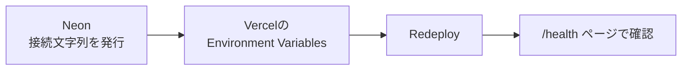

# Vercel × Neon 本番環境変数セットアップ

対象読者：PM/Infra担当（本番の値を扱う人）。開発者の`.env.local`には本番の値を入れない前提は変わらない（[02_tech_spec.md](02_tech_spec.md)3章）。

## 0. 全体像



マイグレーション（テーブル作成）はVercel上では実行しない。PMが手元で`.env.local`を一時的に本番向けに差し替えて`bun run db:migrate`する、既存の運用ルール（[02_tech_spec.md](02_tech_spec.md)6章）のまま。

## 1. Neon側で接続文字列を2つ取得

Neonコンソール → プロジェクト → **Connect** から、以下2本をコピーしておく。

| 用途 | 使う文字列 | 使う場所 |
|---|---|---|
| アプリ実行用 | **Pooled connection**（ホスト名に`-pooler`が付く方） | Vercelの`DATABASE_URL` |
| マイグレーション用 | **Direct connection**（pooler無し） | PMのローカル（一時的に`.env.local`に入れる） |

> サーバーレス関数からの接続はPooled推奨。マイグレーションはpooler経由だと失敗することがあるのでDirectを使う。

## 2. Vercelに環境変数を登録

Vercel dashboard → 対象プロジェクト → **Settings → Environment Variables** で以下を追加。

**Environmentは`Production`と`Preview`の両方にチェックを入れる。** `Production`だけだと、PR用のブランチ（Previewデプロイ）のビルドで環境変数が読み込まれずエラーになる。今の規模なら同じ値をPreviewにも配ってOK。

| 変数名 | 値 | 備考 |
|---|---|---|
| `DATABASE_URL` | NeonのPooled connection文字列 | |
| `NEXTAUTH_SECRET` | `openssl rand -base64 32`で生成したランダム値 | ローカルのダミー値を使い回さない |
| `NEXTAUTH_URL` | `https://〈本番ドメイン〉` | 独自ドメイン未設定なら`https://〈プロジェクト名〉.vercel.app` |
| `ALLOWED_EMAIL_DOMAIN` | 実際の学校ドメイン | 開発時のダミー値(`example.local`)から本物に変更 |

画像アップロード用の`S3_*`系はM2実装時にここに追加する（今回はまだ不要）。

## 3. 再デプロイ

環境変数はデプロイ時にしか読み込まれないため、追加後に再デプロイが必要。

- Vercel dashboard → Deployments → 最新デプロイの「…」→ **Redeploy**
- もしくは何か変更をpushして再デプロイを走らせる

## 4. マイグレーションを本番DBに反映

既存ルール通り、PMのローカルで一時的に`.env.local`を本番向けに差し替えて実行する。

```bash
# .env.local の DATABASE_URL を、1章で取得した Direct connection 文字列に一時的に変更

bun run db:migrate

# 確認が終わったら .env.local を Docker用の値に戻す
```

この時の3ルール（[02_tech_spec.md](02_tech_spec.md)6章）を忘れずに：
1. `.env`/`.env.local`はgit管理しない
2. マイグレーションSQLはPRレビュー済みのものだけ当てる
3. 確認用に作ったデータは後で消す

## 5. 接続確認

新しく追加した確認用ページ `/health`（[src/app/health/page.tsx](../src/app/health/page.tsx)）にアクセスする。

```
https://〈本番ドメイン〉/health
```

| 表示 | 意味 |
|---|---|
| 🟢 接続OK・usersテーブル件数: 0件 | Neonに繋がっていて、マイグレーションも反映済み |
| 🔴 接続NG・エラーメッセージ表示 | `DATABASE_URL`の値、または4章のマイグレーションが未実施かを確認 |

## 6. 確認できたら

`/health`はDBのエラー内容が誰でも見える状態のページなので、本番公開前には削除または管理者限定にする（[03_milestones.md](03_milestones.md) M4に追記済み）。
